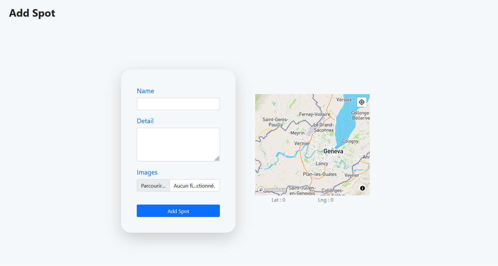
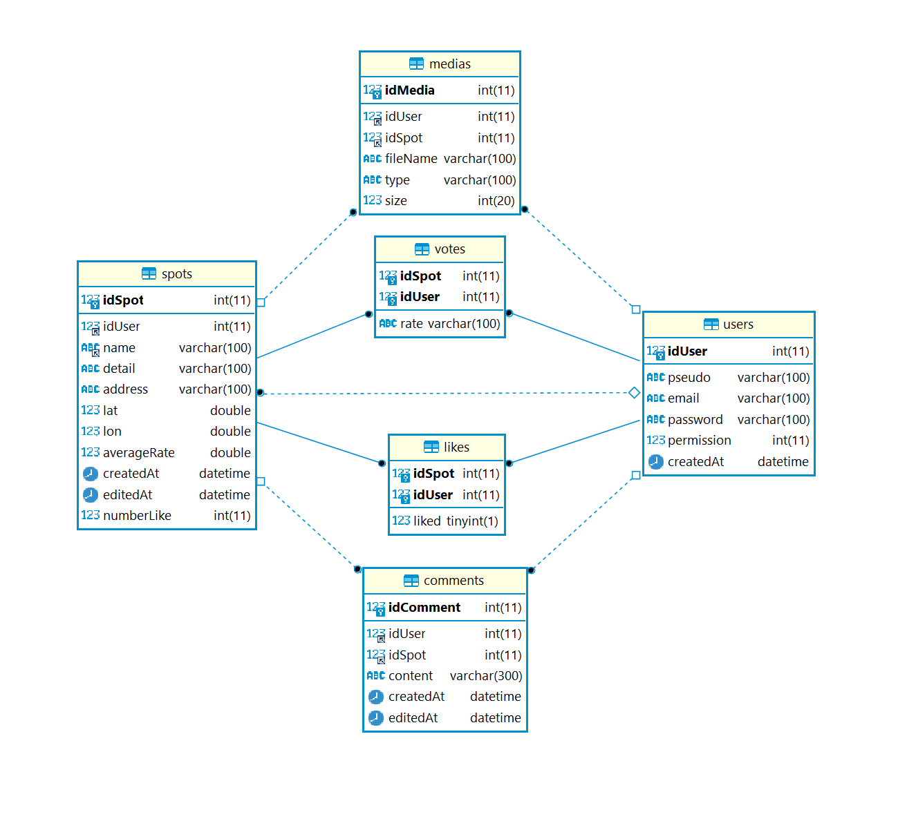

# FitnesSpot

A community web platform to find and share **outdoor fitness spots** (street workout parks, fitness trails) on an interactive map – built in PHP / MySQL with Mapbox.

<p align="center"></p>

> **CFPT Geneva · Swiss Federal VET Diploma (CFC) in IT – final individual practical exam (*TPI*) · May 2021**
> Solo project from an imposed specification, in 11 days / 88 hours: analysis, implementation, tests and documentation.
> All requirements of the specification were delivered on time. 📄 [Full report (French, 53 pages)](docs/report-fr.pdf)

## Features

| Role | What they can do |
|---|---|
| **Visitor** | browse the map of spots, search and filter the list of spots (e.g. only popular ones), view a spot: photos, location, rating, comments |
| **Spotter** (registered user) | sign up / sign in, add a spot (photos + position picked on the map, address filled in by reverse geocoding), comment, like and rate spots (one vote each, the last one counts), manage or delete their profile |
| **Administrator** | is notified by e-mail of new spots and validates them, manages users (search, sort, edit, delete), deletes spots and comments |

The database ships with **~1,800 fitness stations in Switzerland**, imported from OpenStreetMap with an Overpass query.

## Technical highlights

- **MVC architecture** in plain PHP – no framework: models (one class per table), controllers (form and AJAX endpoints), views.
- **Data access with PDO**: a singleton connection, **prepared statements** prepared once per model and **bound typed parameters** – protecting against SQL injection.
- **Viewport-based map loading**: the map only requests the spots inside the visible bounding box (`lat/lon BETWEEN` over AJAX) and removes the markers that leave the screen, so 1,800 spots never load at once.
- **Full-text search**: `MATCH … AGAINST` on `FULLTEXT` indexes (spot name, address, detail; user pseudo and e-mail) instead of `LIKE` full scans.
- **Pagination** in JavaScript with a 7-button navigation (previous / first / … / current ±1 / … / last / next) whose state is computed by a small algorithm, with page counts that follow the active filters.
- **Access control** by role on every protected page and endpoint; passwords stored hashed.

## Methodology

Six-step project method (inform, plan, decide, carry out, check, evaluate), combined with a **Scrum-like product backlog** of 18 user stories that drove the Gantt planning, the daily manual **test scenarios** and a daily work log. Mock-ups and the data model were designed before coding.

<p align="center"></p>

## Project structure

```
www/
├── model/        one PHP class per table + DB connection
├── controller/   endpoints called by the pages (forms and AJAX)
├── view/         pages (PHP + Bootstrap) and JavaScript (maps, pagination, likes / votes)
├── config/       configuration examples (database, Mapbox token)
└── asset/        CSS and images
database/         schema + application user, and default data
docs/             report (French), screenshot, database schema
```

## Getting started

Requirements: PHP 7.4+ with the `pdo_mysql` and `curl` extensions, MySQL or MariaDB, and a free [Mapbox](https://www.mapbox.com/) access token.

```bash
# 1. Database: schema + application user, then the default data
mysql -u root -p < database/dump-fitnesspot_TPI.sql
mysql -u root -p < database/default_data-fitnesspot_TPI.sql

# 2. Configuration: copy the examples and fill in the DB password and Mapbox token
cp www/config/config.inc.example.php www/config/config.inc.php
cp www/config/config.inc.example.js  www/config/config.inc.js

# 3. Run
php -S localhost:8000 -t www
```

Then open <http://localhost:8000>. All demo accounts use the password `demo1234` (administrator: `admin@FitnesSpot.ch`).
E-mail notifications rely on PHP's `mail()` and need a configured mail transport.

## Tech

PHP · MySQL / MariaDB · PDO · JavaScript · jQuery · AJAX · Bootstrap 5 · Mapbox GL JS (maps, geocoding, directions) · OpenStreetMap / Overpass

## Credits & license

- Code: [MIT](LICENSE)
- The `DBConnection` singleton class was provided during a CFPT course
- Spot data © [OpenStreetMap contributors](https://www.openstreetmap.org/copyright), available under the [ODbL](https://opendatacommons.org/licenses/odbl/)
- Demo photos in `www/asset/image/` come from [Unsplash](https://unsplash.com/license) and are not covered by the MIT license
